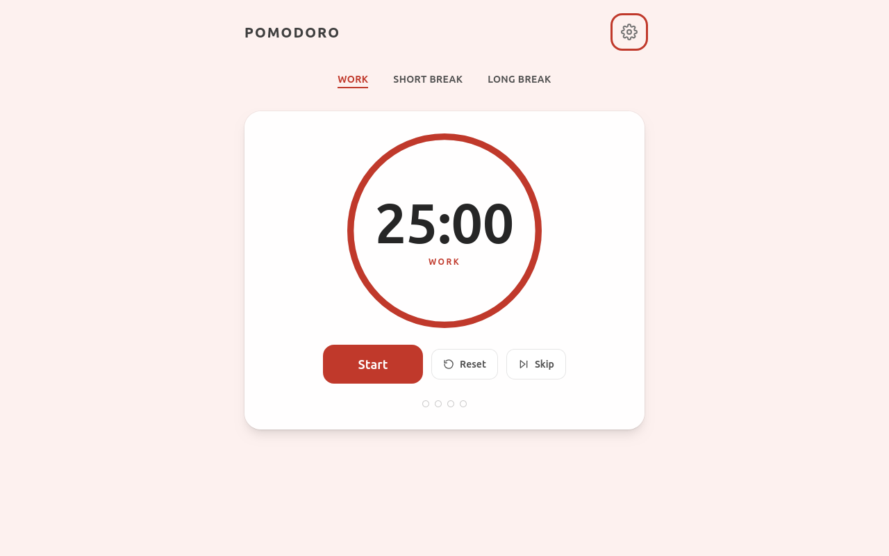
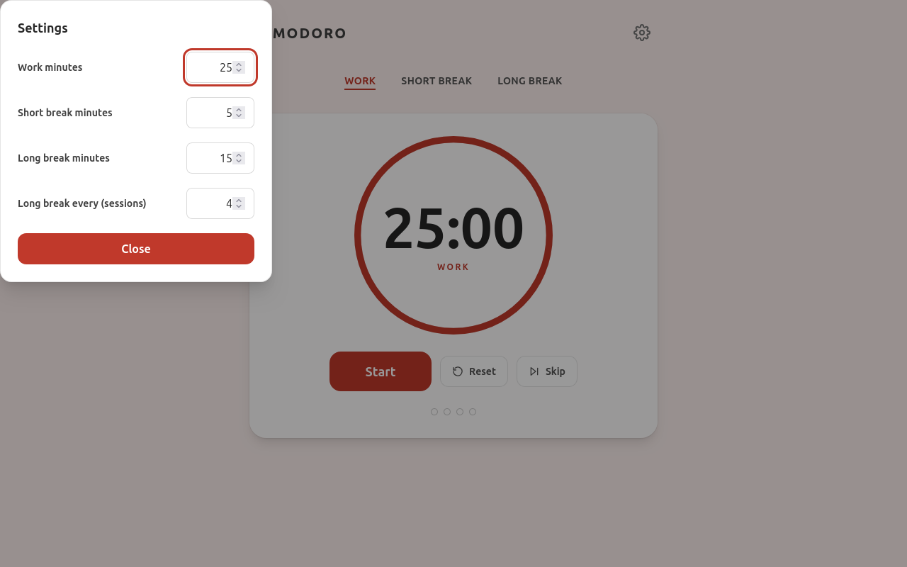
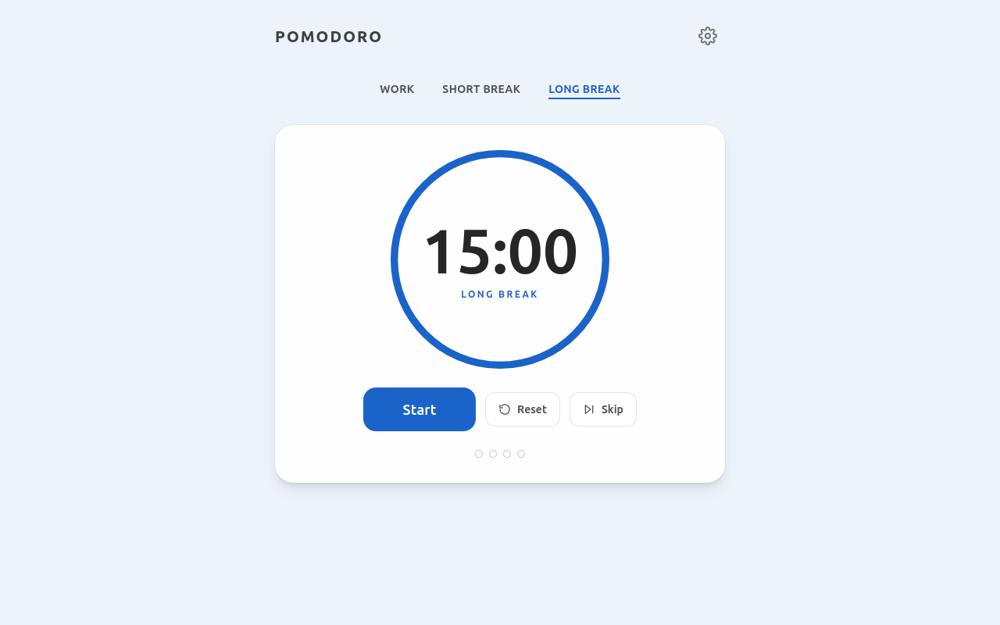
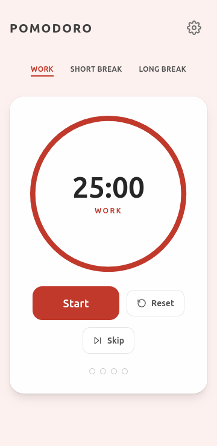
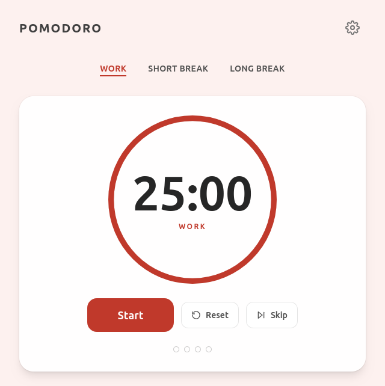

# Informe de pruebas — Pomodoro Timer

| | |
|---|---|
| **Documento** | `TEST-REPORT.md` |
| **Fecha de la campaña** | 19 de octubre de 2026 (14:12 – 14:41 CEST) |
| **Aplicación bajo prueba** | Pomodoro Timer — Vite + React 19 + TypeScript 7 (strict) + Tailwind v4 |
| **Entorno** | Firefox (motor Playwright Firefox 156.0, build `v1553`), Linux x64 |
| **Herramienta** | MCP `@playwright/mcp` 0.0.83, configurado con `--browser firefox` |
| **Alcance** | Funcionalidad, accesibilidad, persistencia, audio, responsive/motion y calidad de código |
| **Resultado global** | ✅ **51/51 comprobaciones PASS** · 0 bloqueadores · 2 hallazgos menores (Bajo) |

---

## 1. Resumen ejecutivo

La aplicación cumple íntegramente el enunciado del ejercicio (iniciar/pausar/reanudar,
intervalos configurables, visualización de fase, contador de sesiones, sonido al finalizar,
responsive y accesible) y las restricciones de `AGENTS.md`.

**Indicadores de la campaña**

| KPI | Valor |
|---|---|
| Comprobaciones ejecutadas | 51 |
| Aprobadas | 51 (100 %) |
| Fallidas / bloqueadores | 0 |
| Hallazgos abiertos | 2 (severidad **Baja**) |
| Errores de consola de la app | 0 (0 warnings) |
| Gates de calidad (`lint` → `typecheck` → `build`) | 3/3 ✅ |
| Capturas de pantalla adjuntas | 5 |

**Hallazgos detectados** (detalle en §6)

1. **Bajo** — `sanitizeSettings`/`clampInt` no aplica techo máximo: un valor de storage
   manipulado (`longMinutes: 999999`) se acepta y se re-persiste.
2. **Bajo** — El efecto de chime/anuncio dice *"only for auto-advance"*, pero `skip` también
   lo dispara y el texto anuncia *"...session complete"* aunque la sesión se haya saltado.

Ninguno de los dos impide el uso normal de la aplicación.

---

## 2. Entorno de prueba

| Componente | Versión / detalle |
|---|---|
| Sistema | Linux x64 (build de fallback `ubuntu24.04-x64` para Playwright) |
| Navegador | **Firefox 156.0** (Playwright build `firefox-1553`) — el usuario trabaja en Firefox |
| Firefox del sistema | Mozilla Firefox 146.0.1 (`/usr/bin/firefox`) — no usado por Playwright |
| Node / npm | v24.21.0 / 11.19.0 |
| Vite / React | 8.3.4 / 19.3.1 |
| TypeScript / Tailwind | 7.0.2 (`strict` + `noUncheckedIndexedAccess`) / 4.3.3 |
| Linter | oxlint 1.88.0 |
| Servidor bajo prueba | `npm run dev` → <http://localhost:5173> |
| Estructura del MCP | `opencode.json` → `npx -y @playwright/mcp@latest --browser firefox` (archivo en `.gitignore`) |

---

## 3. Metodología

- **Interacción real sobre el navegador**: todos los casos se ejecutaron con clics, teclado
  y recargas reales sobre la app en ejecución; nada se simuló a nivel de reducer.
- **Ciclos de tiempo reales**: los auto-avances se observaron esperando sesiones completas
  (work 1 min → descanso 1 min), validando el diseño *timestamp-based* (`endsAt - Date.now()`),
  no *fakes* de reloj.
- **Verificación del audio**: se instrumentó `AudioContext.prototype.createOscillator` en la
  página antes del evento para contar las notas programadas (el chime no es audible por
  automatización).
- **Evidencias**: snapshots de accesibilidad (`.playwright-mcp/page-*.yml`), logs de consola
  (`.playwright-mcp/console-*.log`), payloads de `localStorage` y capturas de pantalla.
- **Gates del proyecto** (orden obligatorio en `AGENTS.md`): `lint` → `typecheck` → `build`.

---

## 4. Capturas de pantalla

### 4.1 Vista general — escritorio 1280×800 (fase Work, acento coral)



*Pestañas de fase ARIA, anillo de progreso con cuenta atrás, controles con etiquetas de estado en
texto (`Start`), puntos de sesión y botón de ajustes. Acento coral de la fase Work.*

### 4.2 Diálogo de ajustes (foco nativo y etiquetas asociadas)



*`<dialog>` modal nativo: focus trap y cierre con Esc gratuitos, `aria-labelledby` en el título y
cada campo `spinbutton` asociado a su `<label>`.*

### 4.3 Fase Long break (cambio de acento por `data-phase`)



*Al seleccionar la pestaña Long break el wrapper cambia `data-phase="long"` y todo el sistema de
color se recolorea desde la variable `--accent` (azul).*

### 4.4 Responsive — 360 px (móvil)



*Sin desbordamiento horizontal (`scrollWidth === clientWidth === 360`) y ningún target táctil
por debajo de 44 px.*

### 4.5 Zoom 200 % (equivalente 640 px de viewport)



*Sin overflow horizontal; el contenido sólo desplaza en vertical, lo que cumple el criterio de
reflow a 200 %.*

---

## 5. Resultados detallados

> **Leyenda:** ✅ PASS · ⚠️ PASS con observación

### 5.1 Funcionalidad del temporizador — `TC-FUN` (17)

| ID | Caso de prueba | Resultado | Evidencia |
|---|---|---|---|
| FUN-01 | Estado inicial por defecto: 25:00, fase Work, `idle`, 0/4 puntos | ✅ | `page-2026-10-19T12-12-16-551Z.yml` |
| FUN-02 | `Start` inicia el conteo (25:00 → 24:48) y la etiqueta pasa a `Pause` | ✅ | Título de página observado |
| FUN-03 | `Pause` congela el reloj (24:35 inmutable durante 3 s) y pasa a `Resume` | ✅ | Snapshots sucesivos idénticos |
| FUN-04 | `Resume` reanuda el descenso | ✅ | 24:35 → 24:33 |
| FUN-05 | `Reset` restaura duración completa y estado `idle` (25:00, `Start`) | ✅ | `page-...T12-14-33-149Z.yml` |
| FUN-06 | `Skip` avanza de fase y auto-arranca la siguiente (comportamiento Pomofocus) | ✅ | Work → Short break 5:00 corriendo |
| FUN-07 | Cada pestaña carga su duración (25:00 / 5:00 / 15:00) | ✅ | Snapshots de tabs |
| FUN-08 | Selección manual de fase → vuelve a `idle` (no sigue corriendo) | ✅ | `Start` tras clic en Long break |
| FUN-09 | `data-phase` y acento por fase (Work coral `rgb(192,57,43)`; Short verde `rgb(35,122,63)`) | ✅ | `getComputedStyle` en página |
| FUN-10 | Atajo `Space` = iniciar/pausar/reanudar | ✅ | Título de página observado |
| FUN-11 | Atajo `R` = reset | ✅ | Reloj a 5:00 tras pulsar |
| FUN-12 | Atajo `S` = skip | ✅ | Fase cambiada a Work |
| FUN-13 | Guard: `Space` sobre botón enfocado produce **un solo** toggle (no dispara dos veces) | ✅ | Estado final `running` |
| FUN-14 | Guard: atajos inertes con el foco dentro del diálogo (`s`, `r` probados) | ✅ | Fase y reloj sin cambios |
| FUN-15 | Guard: `Space` dentro de un input no arranca el temporizador | ✅ | Diálogo abierto, botón sigue en `Start` |
| FUN-16 | Cambiar duración **en caliente** recorta el resto, nunca lo alarga (24:21 → 0:59) | ✅ | Reducer `updateSettings` |
| FUN-17 | `document.title` refleja tiempo + fase en todo momento | ✅ | Título en cada snapshot |

### 5.2 Diálogo de ajustes — `TC-SET` (8)

| ID | Caso de prueba | Resultado | Evidencia |
|---|---|---|---|
| SET-01 | Apertura con foco automático en el primer campo | ✅ | `spinbutton [active]` |
| SET-02 | Cada campo es accesible por nombre (`Work minutes`, etc.) | ✅ | Snapshot de a11y |
| SET-03 | Clamp de máximo: `999` → **120** | ✅ | Valor tras blur |
| SET-04 | Clamp de mínimo: `0` → **1** | ✅ | Valor tras blur |
| SET-05 | Commit con `Enter` y valor correcto al reabrir el diálogo | ✅ | `#work-minutes === "1"` |
| SET-06 | `Esc` cierra el diálogo y devuelve el foco al botón Settings | ✅ | `document.activeElement` |
| SET-07 | Botón `Close` cierra el diálogo (`method="dialog"`) | ✅ | `dialog.open === false` |
| SET-08 | Focus trap nativo: 7 `Tab` consecutivos permanecen dentro | ✅ | `el.closest('dialog')` en bucle |

### 5.3 Persistencia — `TC-PER` (6)

| ID | Caso de prueba | Resultado | Evidencia |
|---|---|---|---|
| PER-01 | Ajustes sobreviven a la recarga (schema `v:1`) | ✅ | `localStorage` leído tras reload |
| PER-02 | `completedPomodoros` sobrevive a la recarga | ✅ | `completedPomodoros: 3` |
| PER-03 | Recarga con el temporizador **corriendo** → arranca en `idle` (`endsAt` no persiste) | ✅ | `Start` + duración completa |
| PER-04 | JSON corrupto (`{not-json!!`) → defaults sin crash | ✅ | Payload reescrito con defaults |
| PER-05 | Shapes inválidos (`'abc'`, `-5`, `0`, `-3`) → defaults | ✅⚠️ | Ver **HALLAZGO-1** (`999999` colado) |
| PER-06 | Versión de schema desconocida (`v: 2`) → defaults | ✅ | Payload reescrito como `v:1` |

### 5.4 Ciclo de sesiones y audio — `TC-CYC` (4)

| ID | Caso de prueba | Resultado | Evidencia |
|---|---|---|---|
| CYC-01 | Auto-avance work → short break con anuncio `aria-live`, +1 punto y persistencia | ✅ | *"Work session complete — short break started"*, `Session 1 of 4` |
| CYC-02 | El descanso **no** incrementa el contador de pomodoros | ✅ | Contador tras descanso intacto |
| CYC-03 | Long break cuando `completedPomodoros % longBreakEvery === 0` | ✅ | *"Work session complete — long break started"*, `longBreakEvery: 1` |
| CYC-04 | Chime sintetizado real en cada transición (4 transiciones → **8 osciladores**, contexto `running`) | ✅ | Spy en `createOscillator` |

### 5.5 Accesibilidad — `TC-A11Y` (7)

| ID | Caso de prueba | Resultado | Evidencia |
|---|---|---|---|
| A11Y-01 | Patrón completo `tablist` / `tab` / `tabpanel` | ✅ | Snapshot de a11y |
| A11Y-02 | `aria-labelledby` del panel dinámico (`tab-short`, `tab-long`, …) | ✅ | Atributo leído en página |
| A11Y-03 | *Roving tabindex*: seleccionado `0`, resto `-1` | ✅ | Atributos `tabindex` |
| A11Y-04 | Navegación del tablist con flechas `←`/`→` (selección + foco) | ✅ | Long break → Short break |
| A11Y-05 | Región `role="status" aria-live="polite"` anuncia cambios de fase | ✅ | Texto del live region |
| A11Y-06 | `:focus-visible` con outline de 3 px en color de acento en todo el tab order | ✅ | `outline: solid 3px rgb(192,57,43)` |
| A11Y-07 | El estado no se comunica sólo por color (`Start`/`Pause`/`Resume` en texto) | ✅ | Etiquetas del botón principal |

### 5.6 Responsive y targets — `TC-RES` (3)

| ID | Caso de prueba | Resultado | Evidencia |
|---|---|---|---|
| RES-01 | 360 px de ancho sin desbordamiento horizontal | ✅ | `scrollWidth === clientWidth === 360` |
| RES-02 | Targets táctiles ≥ 44 px (controles, tabs, panel) | ✅ | `getBoundingClientRect`: 0 infracciones |
| RES-03 | Zoom 200 % (viewport 640 px) sin overflow horizontal (sólo scroll vertical) | ✅ | `scrollWidth 640 / scrollHeight 642` |

### 5.7 Movimiento — `TC-MOT` (2)

| ID | Caso de prueba | Resultado | Evidencia |
|---|---|---|---|
| MOT-01 | `prefers-reduced-motion: reduce` → `.ring-arc { transition: none }` | ✅ | `getComputedStyle` |
| MOT-02 | Sin `reduce` → transición restaurada (`stroke-dashoffset 0.25s, stroke 0.3s`) | ✅ | `getComputedStyle` |

### 5.8 Calidad de código — `TC-QA` (4)

| ID | Caso de prueba | Resultado | Evidencia |
|---|---|---|---|
| QA-01 | Consola de la app sin errores ni warnings durante toda la sesión (108 msgs *info*) | ✅ | `browser_console_messages` |
| QA-02 | `npm run lint` (oxlint 1.88.0) | ✅ | Salida limpia |
| QA-03 | `npm run typecheck` (`tsc -b --noEmit`) | ✅ | Sin errores |
| QA-04 | `npm run build` | ✅ | `built in 6.32s` |

**Total: 51 comprobaciones — 51 PASS.**

---

## 6. Hallazgos

### HALLAZGO-1 — Falta de techo máximo al validar datos persistidos

| Campo | Valor |
|---|---|
| **Severidad** | Baja (robustez) |
| **Ubicación** | `src/features/timer/timerReducer.ts` → `clampInt()` (línea 93) / `src/lib/persistence.ts` → `parsePersisted()` |
| **Condición previa** | `AGENTS.md`: *"validate and merge with defaults on load, never trust stored shapes"* |

**Reproducción**

```js
localStorage.setItem('pomodoro-timer',
  JSON.stringify({ v: 1, settings: { workMinutes: 'abc', shortMinutes: -5,
    longMinutes: 999999, longBreakEvery: 0 }, completedPomodoros: -3 }))
// recargar
```

**Resultado observado**

```json
{"v":1,"settings":{"workMinutes":25,"shortMinutes":5,"longMinutes":999999,"longBreakEvery":4},"completedPomodoros":0}
```

`workMinutes`, `shortMinutes`, `longBreakEvery` y `completedPomodoros` caen correctamente en
defaults, **pero `longMinutes: 999999` se acepta y se re-persiste** (sólo se valida que sea un
entero positivo). Efecto visible: descanso largo de 694 días mostrado como `999999:00`.

**Recomendación**: limitar cada campo a su rango de la interfaz dentro de `clampInt`/`sanitizeSettings`
(p. ej. `workMinutes` 1–120, descansos 1–60, `longBreakEvery` 1–12), de modo que el techo exista
también en la capa de persistencia y no sólo en el diálogo.

---

### HALLAZGO-2 — El chime y el anuncio se disparan también en `skip` manual

| Campo | Valor |
|---|---|
| **Severidad** | Baja (exactitud de texto / documentación) |
| **Ubicación** | `src/features/timer/useTimerEngine.ts` (líneas 49–62) |

**Comentario en el código**

> `// Chime + announcement only for auto-advance: a manual tab switch leaves status idle...`

**Comportamiento real**: `skip` produce un cambio de fase con `status: 'running'`, por lo que
**también** reproduce el chime y publica el anuncio — y el texto afirma *"Work session
**complete**"* aunque la sesión se haya saltado, no completado (verificado: skip Short → Work
sumó +2 osciladores y publicó *"Short break complete — work started"*).

**Recomendación**: distinguir el origen de la transición (auto-avance vs. `skip`) en la acción
del reducer — p. ej. añadir `manual: true` al payload de `skip` — y usar un texto neutro
(*"Short break skipped — work started"*) o suprimir el anuncio cuando no hubo finalización real.
Si el comportamiento es intencional (Pomofocus también suena al saltar), corregir al menos el
comentario para que documente lo que hace el código.

---

### Observación (no es defecto) — Etiqueta de puntos con `longBreakEvery: 1`

Con `longBreakEvery = 1` y 3 sesiones completadas, `SessionDots` anuncia *"Session 1 of 1 toward
the next long break"* porque la fórmula cicla (`completed % every`). Es coherente con el diseño
(dots llenos = toca descanso largo), pero el texto puede confundir a un usuario que lleva 3
sesiones. Sólo aplica a configuraciones con `every = 1`.

---

## 7. Evidencias y artefactos

| Artefacto | Ruta | Contenido |
|---|---|---|
| Capturas (5) | `./pomodoro-*.png` | Escritorio, diálogo, Long break, 360 px, zoom 200 % |
| Snapshots de a11y (35) | `./.playwright-mcp/page-*.yml` | Árbol ARIA por interacción (refs, roles, estados) |
| Logs de consola (5) | `./.playwright-mcp/console-*.log` | Consola completa de Firefox durante la sesión |
| Dev server | `http://localhost:5173` | Sigue activo para revisión manual |

> `.playwright-mcp/` y los PNG **no están en `.gitignore`**; `opencode.json` (configuración del
> MCP) sí lo está.

---

## 8. Conclusión y próximos pasos

La aplicación está **lista para entregar**: 51/51 comprobaciones aprobadas en Firefox real,
sin errores de consola y con los tres gates de calidad en verde. La accesibilidad cumple el
suelo definido en `AGENTS.md` (patrón ARIA completo, live region, focus visible, targets ≥ 44 px,
reduced-motion) y la persistencia resiste recargas y datos corruptos.

**Recomendaciones**

1. Corregir **HALLAZGO-1** (techo máximo en `sanitizeSettings`) — 1 línea por campo, sin riesgo.
2. Resolver **HALLAZGO-2** (texto/comentario del anuncio en `skip`) — decisión de producto.
3. Añadir `.playwright-mcp/` y `pomodoro-*.png` al `.gitignore` o moverlos a `docs/` si se
   conservan como documentación.
4. Opcional: añadir una suite de tests unitarios del reducer (`timerReducer` es puro y ya está
   preparado para ello) para automatizar esta verificación en cada cambio.
